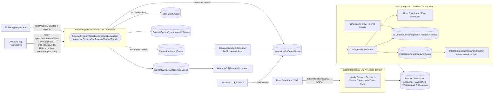

# System map: how the Gain integration solutions fit together

The generated facts (queues, payload drift, shared SQL objects) are in `generated/contracts.md`
and `generated/index.md`. This file explains the flows. Update it when a flow changes.

## The contracts that span solutions

| Contract | Defined in (copies) | Rule |
|---|---|---|
| Integration message (`IntegrationMessageQueue` / `IntegrationMessageQueuePayload` / `IntegrationQueuePayload`) | Outbound, Common.API (x2), MobileApp | Each copy differs (see the drift table in `generated/contracts.md`). Add properties only, never rename or remove, and add the property to every copy that publishes or consumes the message |
| Queue names (`Queues:*` config keys) | appsettings of each solution | Name changes go to every solution in the same release |
| Routing codes (ProcessCode / SubProcessCode) | DMS procs, the mapper table, the `switch` tables in Common.API and Outbound | A new code needs: the mapper row, the Outbound consumer case, the sync consumer case, and the sender |
| `ExternalSystemIntegrationConfigurationMapper` (TSCommon) | DB | Script every row change and attach the script to the PR |
| `integration_response_details` (TSCommon) | Outbound (writes), monitoring APIs, Common.API reads | Columns are shared by the monitoring dashboard. Additive changes only |
| Receipt mode `'W'` skip for RiverSF | Common.API **and** Outbound | Duplicated logic. Change both or neither |

## Things that look wrong but are deliberate (confirm with owners and record them in decisions.md)

- MobileApp CQS areas publish straight to `IntegrationOutBoundQueue`, which skips the Common.API
  router and its mapper lookup. Legacy MobileApp goes through the router.
- The Outbound consumer always ACKs. Retries come from `integration_response_details` and the schedulers.
